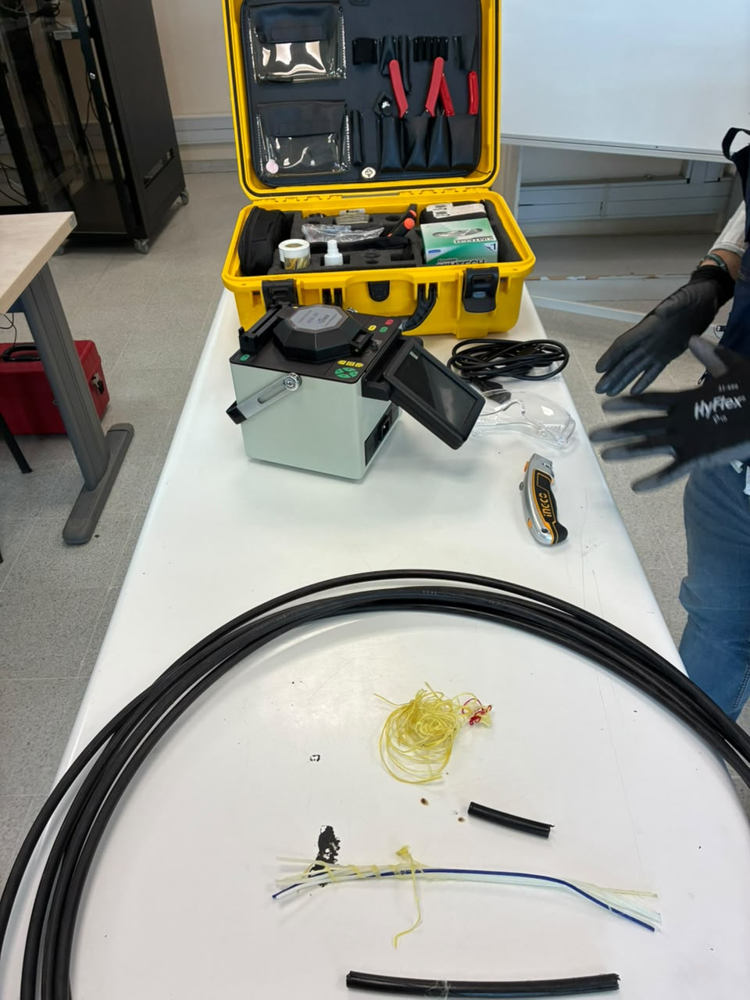
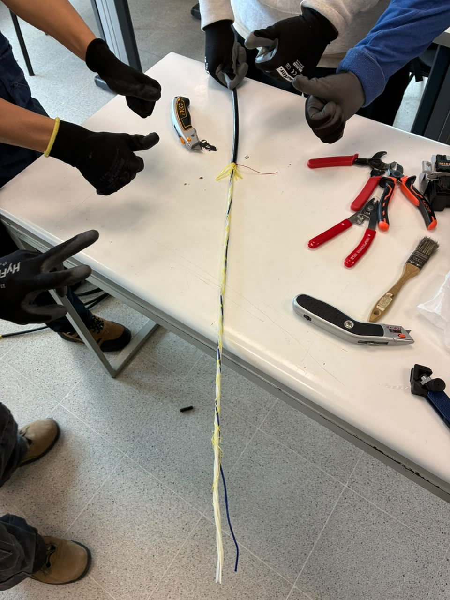
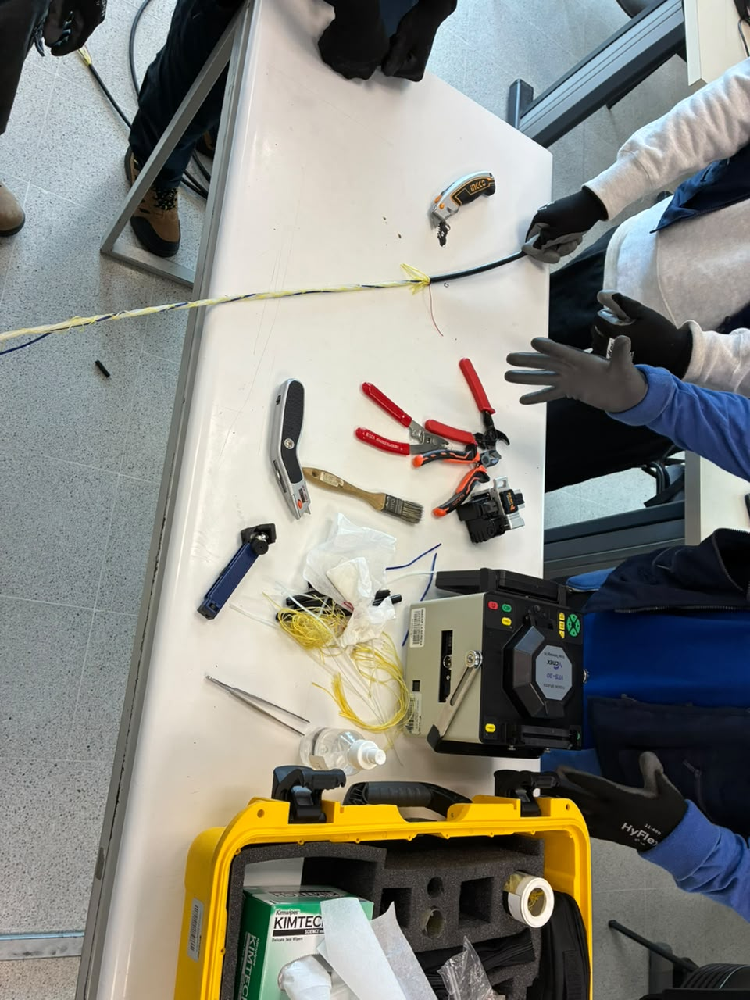
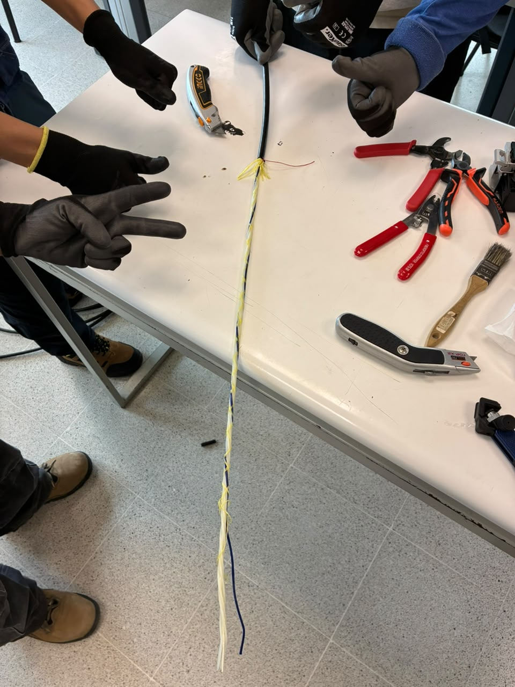
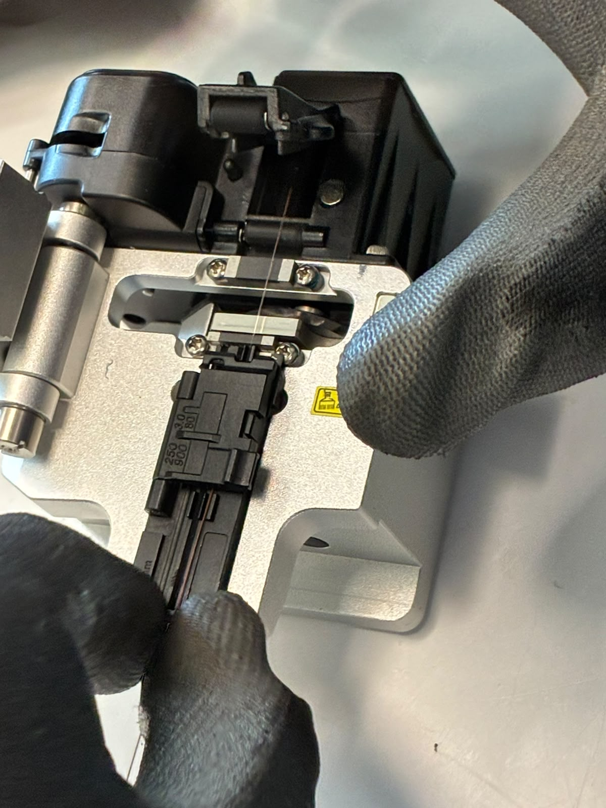
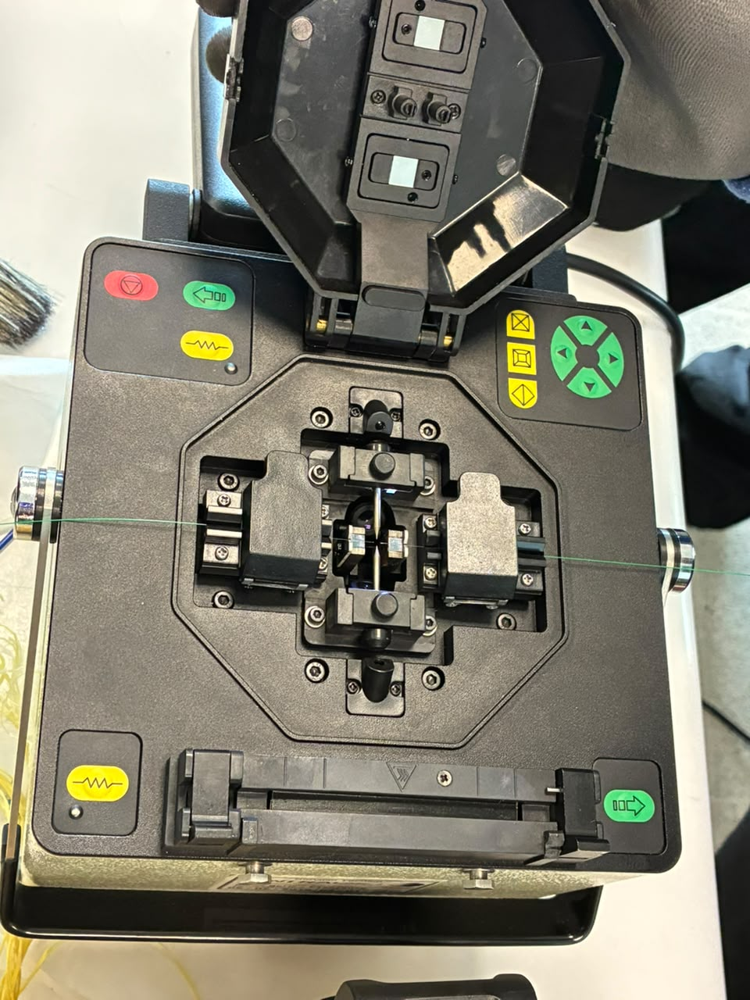
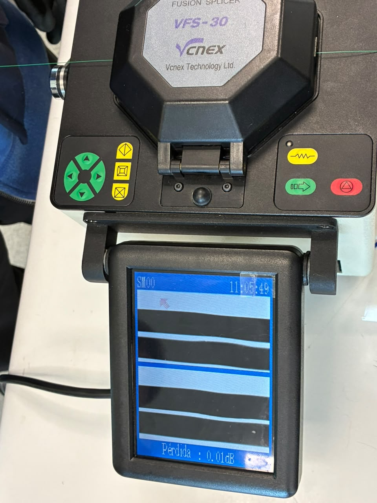
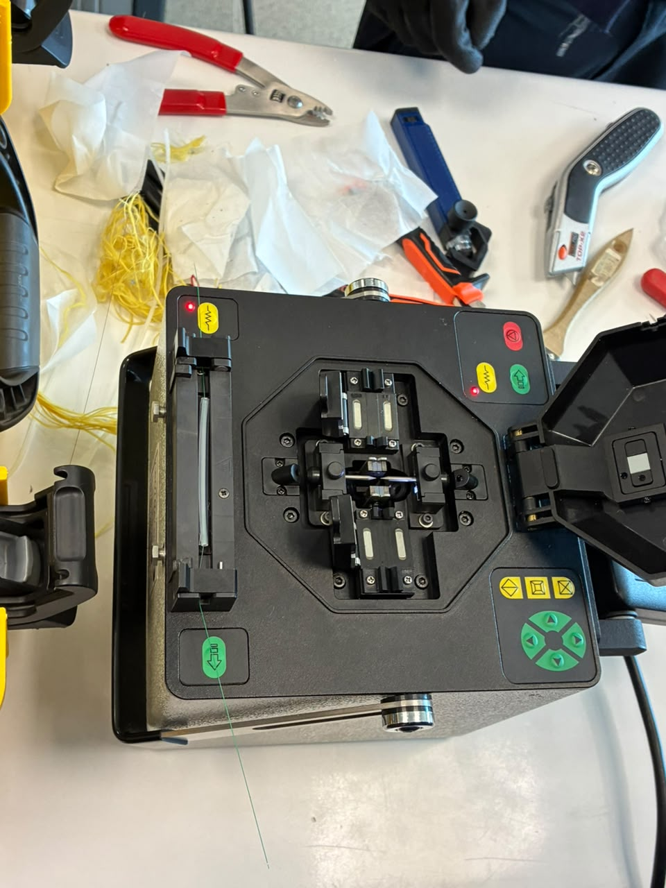
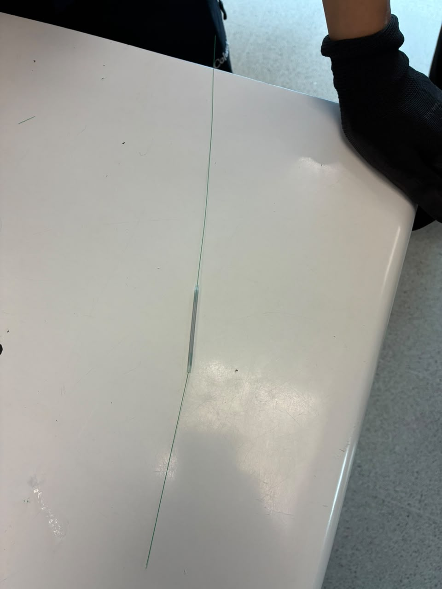

# 🔌 Manual Técnico: Termofusión de Fibra Óptica y Presupuesto Óptico

* 📘  Infraestructura de Redes (TCB304)
* 🎓  Ingeniería en Telecomunicaciones y Servicios Digitales
* 👨‍💻  Autor: Darío Antonio Carvajal Reines
* 📅  Fecha: 14 Noviembre 2026
* 

---

## 📖 1. Glosario Técnico Exprés

* 🔦 Núcleo (Core):Región central de vidrio de sílice dopado por donde viaja la luz mediante reflexión interna total.
* 🛡️ Cladding (Revestimiento): Capa de vidrio de con menor índice de refracción que rodea al núcleo para confinar el haz óptico.
* ✂️ Cleaving (Corte de Precisión):Marcado y fractura mecánica controlada del vidrio para lograr una cara transversal limpia.
* 📉 Atenuación:Pérdida de potencia óptica a lo largo del enlace producida por absorción, dispersión, empalmes y conectores.

---

## 🦺 2. Seguridad, EPP y Gestión de Residuos

Antes de intervenir el cable de fibra óptica, se prepara la estación de trabajo verificando los Elementos de Protección Personal (EPP) y los contenedores de seguridad.

   
  <b>Fig 1.</b> Estación de trabajo, lentes de seguridad, guantes HyFlex y contenedor amarillo de desechos.

1. 🥽 Protección Ocular y Manual: Uso obligatorio de **lentes de seguridad** (visibles junto a la fusionadora) para proteger contra microfragmentos de vidrio y **guantes de precisión para manipular herramientas de corte con firmeza.
2. 🗑️ **Disposición Segura de Residuos:** Todos los recortes de fibra se depositan de inmediato en el contenedor.
   
> **⚠️ ADVERTENCIA DE SEGURIDAD:** Nunca mire directamente el extremo de una fibra conectada ni limpie restos de vidrio sobre la ropa o la mesa. Los fragmentos microscópicos de sílice pueden penetrar la piel.
---

## 🛠️ 3.  Paso a Paso: Termofusión por Arco Eléctrico

### 🔹 Paso 1: Remoción de Chaqueta Exterior y Elementos de Tracción
1. Sujete el cable troncal de planta externa utilizando guantes de seguridad y realice un corte anular superficial en la cubierta negra de polietileno (PE) con cortacables o cuchillo retráctil.
2. Tire del hilo de rasgado rojo (*ripcord*)** en sentido longitudinal para abrir la cubierta sin dañar los tubos internos y recorte las fibras de aramida (Kevlar) amarillas.

<table>
  <tr>
    <td align="center">
       
      <b>Fig 2.</b> Remoción de chaqueta exterior y Kevlar.
    </td>
    <td align="center">
       
      <b>Fig 3.</b> Aislamiento de tubos holgados en estación.
    </td>
  </tr>
</table>

---

### 🔹 Paso 2: Manguito Termo-contraíble y Limpieza
1. Antes de pelar el recubrimiento primario, inserte el manguito termo-contraíble  por uno de los extremos del hilo.
2. Emplee la pinza peladora calibrada para retirar el acrilato y dejar expuesto el vidrio.
3. Humedezca un paño libre de pelusa con **alcohol isopropílico  y limpie el vidrio en un solo sentido desde el recubrimiento hacia la punta.

   
  <b>Fig 4.</b> Hilos de fibra desnuda junto a paños libres de pelusa Kimwipes.

---

### 🔹 Paso 3: Corte de Precisión 
1. Abra la cortadora de precisión y verifique que la cuchilla de carburo de tungsteno esté retraída.
2. Coloque la fibra limpia en la canaleta guía de vidrio expuesto según la regla graduada.
3. Cierre la prensa, accione el carro de corte en un movimiento continuo y deposite el sobrante en el recipiente de desechos.

   
  <b>Fig 5.</b> Posicionamiento del hilo en cortadora de precisión (cleaver) para corte a 90°.

---

### 🔹 Paso 4: Alineación de Núcleos y Termofusión 
1. Levante la cubierta protectora y las prensas de la fusionadora 
2. Posicione cuidadosamente ambos extremos sobre las ranuras en V , ubicando las puntas entre los electrodos sin tocar las guías cerámicas.
3. Cierre las prensas y la tapa superior para ejecutar el ciclo automático|

   
<table>
  <tr>
    <td align="center">
       
      <b>Fig 6.</b> Sujeción de fibras en ranuras en V.
    </td>
    <td align="center">
       
      <b>Fig 7.</b> Pantalla VFS-30: Pérdida estimada de 0.01 dB.
    </td>
  </tr>
</table>

---

### 🔹 Paso 5: Protección Mecánica con Manguito Termo-contraíble
1. Retire suavemente la fibra fusionada manteniendo leve tensión axial y deslice el manguito termo-contraíble hasta centrar la aguja de acero inoxidable sobre el punto de empalme.
2. Introduzca el conjunto en el horno calefactor izquierdo y presione el botón térmico (indicador LED rojo encendido) hasta completar el sellado.

<table>
  <tr>
    <td align="center">
       
      <b>Fig 8.</b> Contracción térmica en horno calefactor.
    </td>
    <td align="center">
       
      <b>Fig 9.</b> Empalme finalizado con manguito curado.
    </td>
  </tr>
</table>

---

## 📊 4. Análisis de Resultados y Presupuesto Óptico (Enlace GPON)

Para validar la viabilidad del enlace bajo estándar **ITU-T G.984 (GPON Clase B+)**, se calcula la atenuación teórica total considerando fibra monomodo OS2 ($1310/1490\ \text{nm}$), empalmes por fusión, conectores y margen operativo.

### 🧮 4.1. Tabla de Cálculo del Presupuesto Óptico

| Componente del Enlace | Cantidad | Atenuación Unitaria Estándar | Pérdida Total ($\text{dB}$) | Referencia / Norma |
| :--- | :---: | :---: | :---: | :--- |
| 🌐 Fibra Óptica Monomodo ($1310\ \text{nm}$) | $2.5\ \text{km}$ | $0.35\ \text{dB/km}$ | $0.88\ \text{dB}$ | ITU-T G.652.D |
| ⚡ Empalmes por Termofusión | $2\ \text{unid.}$ | $0.05\ \text{dB/empalme}$ | $0.10\ \text{dB}$ | TIA-568.3-D |
| 🔌 Conectores Ópticos (SC/APC) | $2\ \text{pares}$ | $0.30\ \text{dB/par}$ | $0.60\ \text{dB}$ | TIA-568.3-D |
| 🔀 Divisor Óptico (Splitter $1:8$) | $1\ \text{unid.}$ | $10.50\ \text{dB}$ | $10.50\ \text{dB}$ | Arquitectura FTTH/GPON |
| 🛡️ Margen de Seguridad y Envejecimiento | $1\ \text{global}$ | $3.00\ \text{dB}$ | $3.00\ \text{dB}$ | Buena práctica Planta Externa |
| **🎯 ATENUACIÓN TOTAL ESTIMADA** | — | — | **$15.08\ \text{dB}$** | **✅ Cumple GPON Clase B+ ($\le 28\ \text{dB}$)** |

### 🔬 4.2. Registro de Medición y Verificación en Taller

| Parámetro Evaluado | Valor Obtenido en Taller | Umbral Máximo Permitido | Estado |
| :--- | :---: | :---: | :---: |
| ⚙️ **Perfil de Fusión Utilizado** | `SM00` (Monomodo estándar) | Compatible ITU-T G.652 | ✅ Aprobado |
| 📉 **Pérdida estimada por fusionadora** | **$0.01\ \text{dB}$** | $\le 0.05\ \text{dB}$ | 🌟 Sobresaliente |
| 🔍 **Integridad física del manguito** | Centrado, transparente y sin burbujas | Sin burbujas ni exposición | ✅ Aprobado |

> **💡 Conclusión Técnica:** La termofusión ejecutada  obtuvo una pérdida estimada de **$0.01\ \text{dB}$** (cinco veces inferior al umbral máximo normativo de $0.05\ \text{dB}$), evidenciando un corte  limpio y una alineación óptima.
